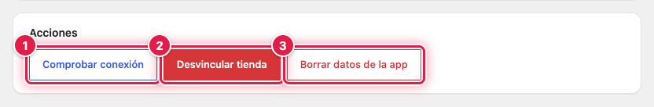
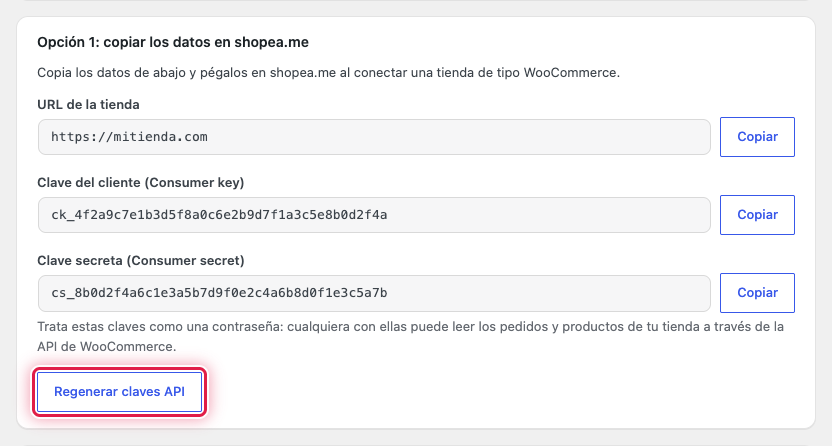

Con la tienda vinculada, la página **Shopeame** muestra la sección **Acciones** con tres botones: comprobar que la
conexión con shopea.me funciona, desvincular la tienda o borrar solo los datos de conexión guardados en WordPress.
Mientras no está vinculada, la misma página permite volver a generar las claves de la API.

## ⚡ Las acciones de la tienda vinculada

Ve al menú **Shopeame**. En **Acciones** tienes **Comprobar conexión** (1), **Desvincular tienda** (2) y **Borrar datos
de la app** (3).

## 🔍 Comprobar la conexión

Pulsa **Comprobar conexión**. Si shopea.me reconoce la tienda, aparece **La conexión con shopea.me funciona
correctamente.**; si no, **No se pudo confirmar la conexión con shopea.me.** (consulta la página de errores).

La página también lo comprueba cada vez que la abres: si la tienda se ha desvinculado desde shopea.me, vuelve a
mostrar las opciones para vincularla. Si shopea.me no responde en ese momento, la tienda sigue apareciendo como
vinculada con el aviso **No se pudo conectar con shopea.me para confirmar la vinculación de la tienda.**

## 🔌 Desvincular la tienda

1. Pulsa **Desvincular tienda**.
2. Acepta el aviso **Esta acción desvinculará la tienda de Shopeame. ¿Quieres continuar?**.

La tienda se da de baja en shopea.me, deja de sincronizar pedidos y WordPress borra los datos de la vinculación. El
aviso **Tienda desvinculada de shopea.me.** lo confirma. Si shopea.me no responde, verás **Se borraron las credenciales
locales, pero shopea.me no confirmó la desvinculación.**: la tienda queda desvinculada en WordPress y puedes
desactivarla también desde shopea.me.

Las claves de la API se conservan, así que puedes volver a vincular la tienda cuando quieras. Si lo haces con el mismo
ERP, shopea.me la reactiva con su configuración.

## 🧹 Borrar los datos de la app

Usa **Borrar datos de la app** cuando la tienda ya no exista en shopea.me o hayas restaurado una copia de la web con
datos de otra vinculación.

1. Pulsa **Borrar datos de la app**.
2. Acepta el aviso **Esta acción solo borrará los datos de conexión guardados en la app y no modificará Shopeame.
   ¿Quieres continuar?**.

Solo se borran los datos de la vinculación guardados en WordPress, sin avisar a shopea.me y sin tocar las claves de la
API. Aparece **Se borraron los datos de conexión de la app sin modificar ShopeameServer.** y la página vuelve a mostrar
las dos formas de vincular.

## 🔑 Regenerar las claves de la API

Con la tienda sin vincular, la **Opción 1** muestra el botón **Regenerar claves API**. Al pulsarlo se borran las claves
anteriores del plugin y se crean otras nuevas; shopea.me deja de poder usar las antiguas.

⚠️ Después de regenerarlas, vuelve a vincular la tienda para que shopea.me reciba las claves nuevas.

## Ver también

- [Cómo vincular la tienda copiando los datos en shopea.me](como-vincular-la-tienda-copiando-los-datos-en-shopeame.md)
- [Cómo vincular la tienda con el UUID y el token del ERP](como-vincular-la-tienda-con-el-uuid-y-el-token-del-erp.md)
- [Cómo resolver los errores de Shopeame en WooCommerce](como-resolver-los-errores-de-shopeame-en-woocommerce.md)
