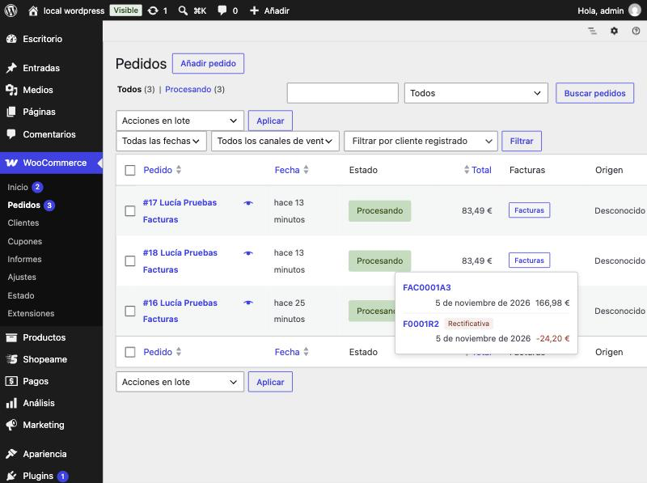
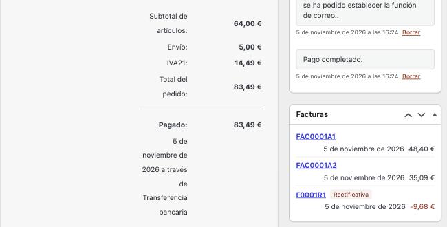
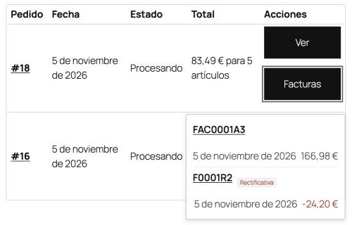
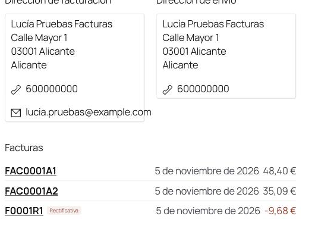

Cuando facturas en tu ERP un pedido que llegó desde la tienda, puedes descargar sus facturas en PDF desde el propio
WooCommerce, sin entrar en el ERP, y tus clientes pueden descargarlas desde **Mi cuenta**. Aparecen todas las facturas
del pedido: las facturas parciales, la factura que agrupa ese pedido con otros del mismo cliente y las facturas
rectificativas.

## ⚙️ Antes de empezar

- La tienda está vinculada con shopea.me y el pedido ya ha llegado a tu ERP.
- El pedido está facturado en el ERP (si todavía no lo está, la lista sale vacía).
- Tu ERP está encendido y con conexión: las facturas se piden al ERP en el momento.
- Entras en WordPress con un usuario que puede gestionar pedidos (administrador o gestor de la tienda).

## 📋 Desde el listado de pedidos

1. Ve a **WooCommerce** → **Pedidos**.
2. En la columna **Facturas**, pulsa el botón **Facturas** del pedido.
3. Se abre una lista con las facturas del pedido: código, fecha y total. Las rectificativas llevan la etiqueta
   **Rectificativa** y el total en rojo; si pasas el ratón por la etiqueta, verás qué factura rectifican.
4. Pulsa el código de una factura para descargar su PDF.

Para cerrar la lista, pulsa fuera de ella o la tecla **Esc**.

## 🧾 Desde la ficha del pedido

Abre el pedido: en la barra lateral, el cuadro **Facturas** muestra sus facturas en cuanto se carga la página. Pulsa el
código de una factura para descargar su PDF.

## 👤 Tus clientes, desde Mi cuenta

Tus clientes pueden descargar las facturas de sus propios pedidos sin pedírtelas:

- En **Mi cuenta** → **Pedidos**, cada pedido tiene el botón **Facturas** junto a **Ver**. Al pulsarlo se despliega la
  lista de facturas; al pulsar un código se descarga el PDF.
- Al ver un pedido, la sección **Facturas** muestra sus facturas debajo de las direcciones.

Cada cliente solo ve las facturas de los pedidos de su cuenta. Si el ERP no responde, el cliente ve **Las facturas no
están disponibles ahora mismo. Inténtalo más tarde.**, sin más detalles.

Para que tus clientes no vean las facturas, ve a la página **Shopeame**, desmarca **Permitir que los clientes
descarguen las facturas de sus pedidos desde Mi cuenta** en la sección **Facturas** y pulsa **Guardar**. Viene marcada
al instalar el plugin.

## 💡 Cosas a tener en cuenta

- **Siempre están al día**: cada vez que abres la lista, shopea.me pregunta al ERP. Si creas una rectificativa o borras
  una factura en el ERP, lo verás la próxima vez que la abras.
- **Facturas que agrupan varios pedidos**: si en el ERP facturaste juntos varios pedidos del mismo cliente, esa factura
  aparece en cada uno de ellos, y también sus rectificativas.
- **Las facturas no se guardan en WordPress**: el PDF pasa por shopea.me hasta tu navegador.

## 🚨 Si no aparecen las facturas

| Mensaje | Qué hacer |
|---|---|
| **Este pedido aún no tiene facturas en el ERP.** | El pedido no está facturado o no llegó al ERP. Revisa en el ERP que el pedido de la tienda está facturado. |
| **Tu ERP no está disponible ahora mismo. Inténtalo más tarde.** | El ERP está apagado o sin el plugin Shopeame. Cuando vuelva a estar disponible, pulsa **Volver a cargar**. |
| **Tu ERP no permite descargar facturas. Actualiza FacturaScripts y el plugin Shopeame.** | Actualiza FacturaScripts y el plugin Shopeame del ERP. |
| **shopea.me todavía no permite descargar facturas.** | shopea.me aún no tiene esta función. Prueba más adelante. |
| **La tienda no está vinculada con shopea.me.** | Ve a la página **Shopeame** y pulsa **Comprobar conexión**; si hace falta, vuelve a vincular la tienda. |
| **No se ha podido conectar con shopea.me. Inténtalo de nuevo en unos minutos.** | Tu servidor no ha podido conectar con shopea.me. Espera y vuelve a intentarlo. |

Los fallos también se anotan en **WooCommerce** → **Estado** → **Registros**, con la fuente `shopeame`.

## Ver también

- [Cómo funciona el plugin Shopeame para WooCommerce](como-funciona-shopeame-para-woocommerce.md)
- [Cómo resolver los errores de Shopeame en WooCommerce](como-resolver-los-errores-de-shopeame-en-woocommerce.md)
