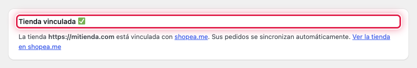

El plugin **Shopeame** conecta tu tienda WooCommerce con shopea.me, el servicio que lleva los pedidos de tu tienda
online a tu ERP. Una vez vinculada la tienda, cada pedido nuevo o modificado se avisa a shopea.me al momento, y
shopea.me lo descarga y lo crea en el ERP sin que tengas que copiar nada a mano.

El plugin no cambia nada en tu tienda: solo crea unas claves de la API de WooCommerce de **solo lectura** para que
shopea.me pueda leer los pedidos y los productos, y avisa cuando hay un pedido nuevo.

## ⚙️ Antes de empezar

- Una tienda WordPress con **WooCommerce** activo y servida por HTTPS.
- Una cuenta en shopea.me con tu ERP ya registrado.

## 🔄 Cómo funciona

1. Instalas y activas el plugin, que añade la página **Shopeame** al menú de WordPress.
2. Vinculas la tienda con tu ERP de shopea.me de una de estas dos formas:
   - **Opción 1: copiar los datos en shopea.me**. Copias de WordPress la URL de la tienda y las claves de la API y las
     pegas en shopea.me.
   - **Opción 2: vincular indicando tu ERP**. Copias de shopea.me el UUID y el token de tu ERP y los pegas en
     WordPress.
3. A partir de ahí, cada vez que se crea o se modifica un pedido, el plugin avisa a shopea.me con el número del pedido.
   shopea.me lo descarga y lo lleva al ERP.

## 🔒 Qué datos se envían a shopea.me

- Al vincular: la URL de la tienda y las claves de la API de WooCommerce y, en la opción 2, el UUID y el token del ERP.
- Con cada pedido nuevo o modificado: solo el número del pedido. El resto de datos (cliente, direcciones, productos y
  totales) los lee shopea.me con las claves de solo lectura.
- Antes de vincular la tienda, el plugin no envía nada.

Si eliminas el plugin desde **Plugins**, se borran sus datos y las claves de la API que creó, y shopea.me deja de tener
acceso a la tienda.

## Ver también

- [Cómo instalar el plugin Shopeame](como-instalar-el-plugin-shopeame.md)
- [Cómo vincular la tienda copiando los datos en shopea.me](como-vincular-la-tienda-copiando-los-datos-en-shopeame.md)
- [Cómo vincular la tienda con el UUID y el token del ERP](como-vincular-la-tienda-con-el-uuid-y-el-token-del-erp.md)
