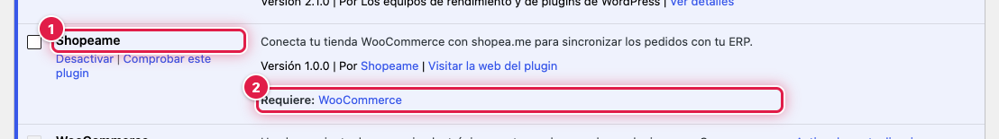
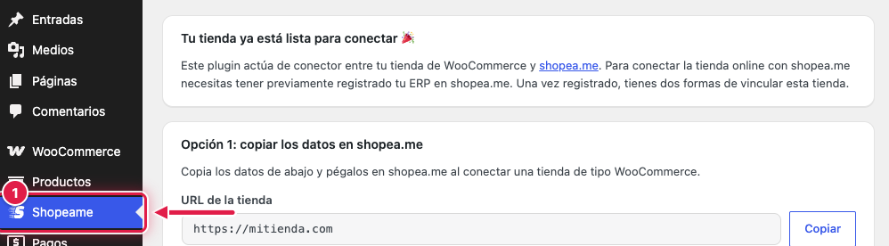

El plugin **Shopeame** se instala como cualquier otro plugin de WordPress, desde el directorio oficial de plugins.
Necesita **WooCommerce** activo: WordPress no deja activarlo sin él.

## ⚙️ Antes de empezar

- Entra en el escritorio de WordPress con un usuario administrador.
- Comprueba que **WooCommerce** está instalado y activo en **Plugins**.

## 📥 Instalar y activar el plugin

1. Ve a **Plugins** → **Añadir plugin**.
2. Busca «Shopeame».
3. Pulsa **Instalar ahora** en la tarjeta del plugin Shopeame y después **Activar**.

En la lista de **Plugins** verás el plugin **Shopeame** (1) activo, con la indicación **Requiere: WooCommerce** (2).

## 🧭 Abrir la página del plugin

Al activarlo aparece el menú **Shopeame** (1) en el menú lateral del escritorio. Desde ahí se vincula la tienda con
shopea.me y se gestiona la conexión.

Mientras la tienda no está vinculada, la página muestra **Tu tienda ya está lista para conectar 🎉** y las dos formas de
vincularla.

## Ver también

- [Cómo funciona el plugin Shopeame para WooCommerce](como-funciona-shopeame-para-woocommerce.md)
- [Cómo vincular la tienda copiando los datos en shopea.me](como-vincular-la-tienda-copiando-los-datos-en-shopeame.md)
- [Cómo vincular la tienda con el UUID y el token del ERP](como-vincular-la-tienda-con-el-uuid-y-el-token-del-erp.md)
