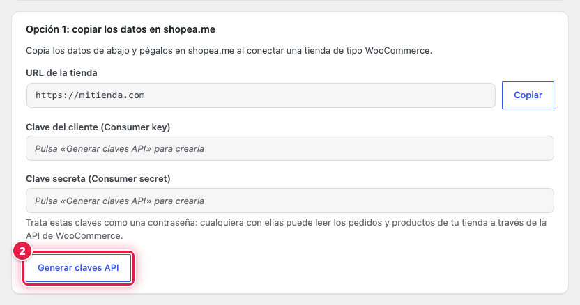
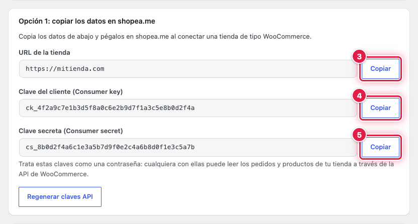
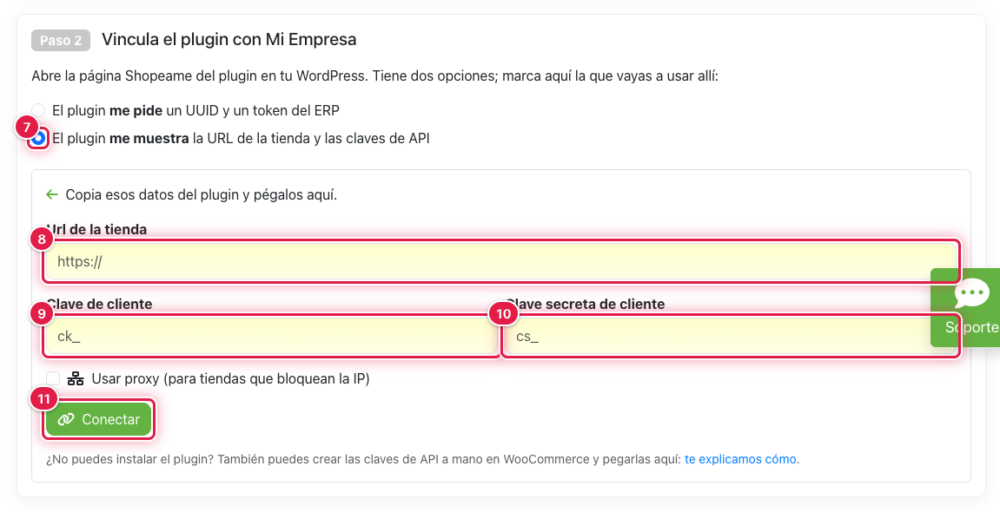
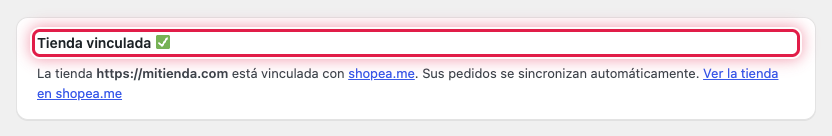

Con esta opción generas en WordPress las claves de la API de WooCommerce y las pegas en shopea.me junto con la URL de
la tienda. shopea.me comprueba que puede conectarse, crea la tienda en tu ERP y envía a WordPress los datos de la
vinculación, así que no tienes que volver a WordPress para terminar.

## ⚙️ Antes de empezar

- El plugin Shopeame instalado y activo.
- Tu ERP registrado en shopea.me.

## 🔑 Generar y copiar los datos en WordPress

1. Ve al menú **Shopeame**.
2. En **Opción 1: copiar los datos en shopea.me**, pulsa **Generar claves API**.

Aparece el aviso **Claves API generadas correctamente.** y los campos se rellenan.

3. Pulsa **Copiar** junto a **URL de la tienda**.
4. Pulsa **Copiar** junto a **Clave del cliente (Consumer key)**.
5. Pulsa **Copiar** junto a **Clave secreta (Consumer secret)**.

Copia y pega los datos de uno en uno en shopea.me (pasos siguientes), o guárdalos un momento en un lugar seguro.

⚠️ Trata estas claves como una contraseña: con ellas se pueden leer los pedidos y los productos de tu tienda. Son de
solo lectura y puedes revocarlas en **WooCommerce** → **Ajustes** → **Avanzado** → **API REST**.

## 🔗 Pegar los datos en shopea.me

6. En shopea.me, abre tu ERP, ve a la pestaña de tiendas y pulsa **Conectar** en **Conectar una tienda online o
   marketplace**. Elige **WooCommerce**.
7. En **Paso 2**, marca **El plugin me muestra la URL de la tienda y las claves de API**.
8. Pega la URL de la tienda en **Url de la tienda**.
9. Pega la consumer key en **Clave de cliente**.
10. Pega la consumer secret en **Clave secreta de cliente**.
11. Pulsa **Conectar**.

shopea.me muestra **La tienda ha sido conectada correctamente. Ahora debes terminar de configurar tus opciones.** y te
lleva a la configuración de la tienda.

## ✅ Comprobar la vinculación

Vuelve al menú **Shopeame** de WordPress: ahora indica **Tienda vinculada ✅**. Desde ese momento los pedidos se
sincronizan solos.

Si la página sigue mostrando las dos opciones, shopea.me no ha podido enviar los datos a WordPress (por ejemplo,
porque la tienda no usa HTTPS o un cortafuegos bloquea la petición). La tienda sí está creada en shopea.me: termina la
vinculación con la opción 2, con el UUID y el token de tu ERP; el plugin recupera la tienda existente sin crear otra.

## Ver también

- [Cómo vincular la tienda con el UUID y el token del ERP](como-vincular-la-tienda-con-el-uuid-y-el-token-del-erp.md)
- [Cómo comprobar, desvincular o borrar los datos de la tienda](como-comprobar-desvincular-o-borrar-los-datos-de-la-tienda.md)
- [Cómo resolver los errores de Shopeame en WooCommerce](como-resolver-los-errores-de-shopeame-en-woocommerce.md)
